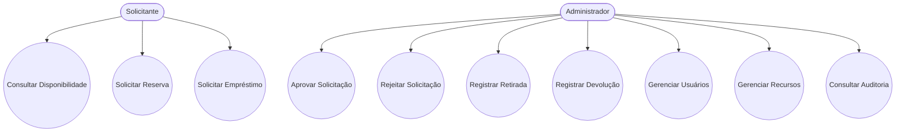
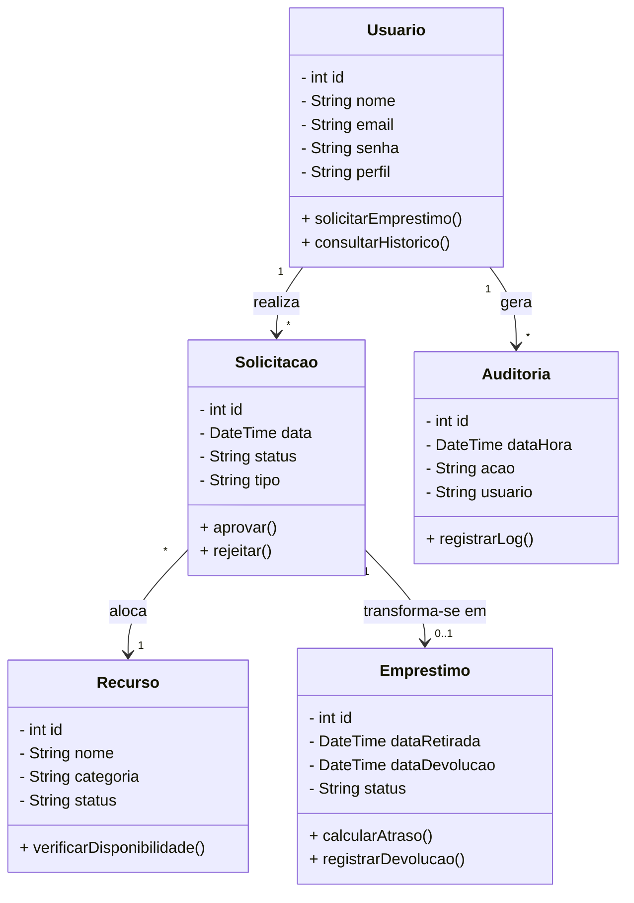
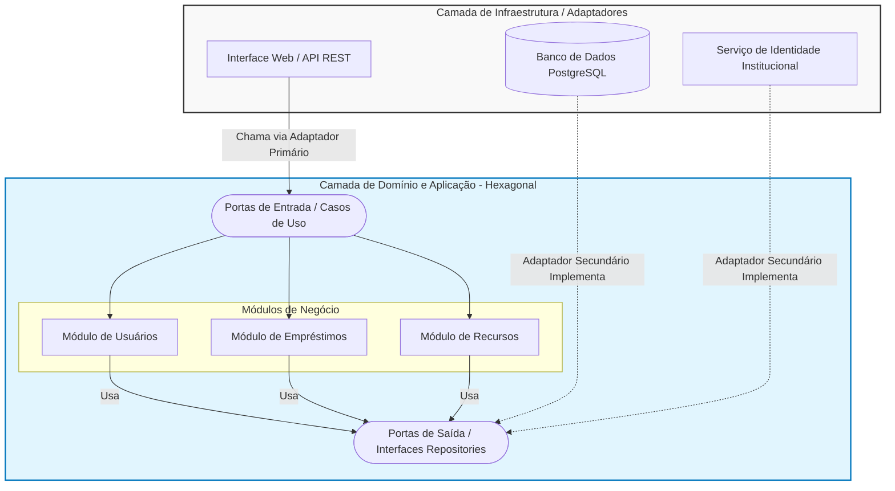
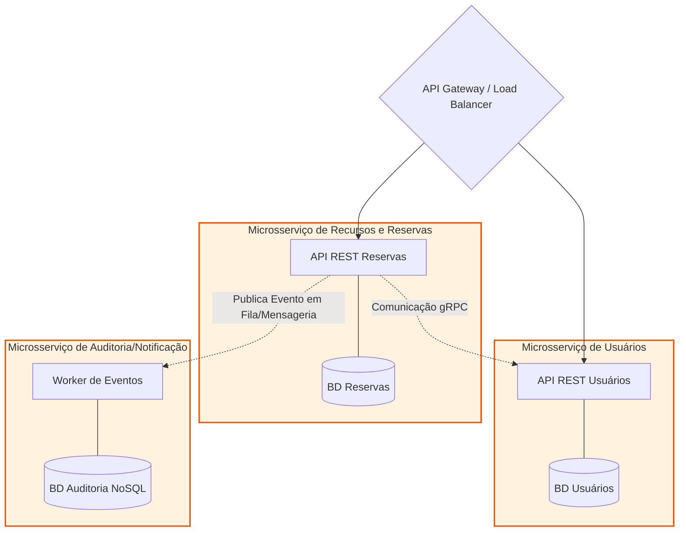

# SIGER - Sistema Integrado de Gestão de Empréstimos e Reservas

> Projeto desenvolvido para a disciplina de **Análise Orientada a Objetos e Projeto Arquitetural**.

## 📖 Sobre o Projeto

O **SIGER (Sistema Integrado de Gestão de Empréstimos e Reservas)** é uma solução destinada ao gerenciamento de recursos institucionais, permitindo o controle centralizado de reservas, empréstimos, devoluções e auditoria de equipamentos e ambientes.

Atualmente, muitas instituições realizam esse processo manualmente através de planilhas e registros dispersos, o que aumenta a ocorrência de conflitos de agendamento, perdas de controle e dificuldades de rastreamento.

O SIGER foi projetado para automatizar e organizar esse processo, garantindo maior eficiência, segurança e rastreabilidade.

---

## 🎯 Objetivos

- Centralizar a gestão dos recursos institucionais.
- Controlar empréstimos e reservas.
- Reduzir conflitos de agendamento.
- Garantir rastreabilidade das operações.
- Facilitar auditorias e aplicação de penalidades.

---

## 🏢 Recursos Gerenciados

O sistema permitirá o gerenciamento dos seguintes recursos:

- 💻 Notebooks
- 📱 Tablets
- 📽️ Projetores
- 📷 Câmeras
- 🏫 Laboratórios
- 🏢 Salas de Reunião

---

# 👥 Atores do Sistema

## Solicitante

Representa:

- Alunos
- Professores
- Colaboradores

Responsável por:

- Consultar disponibilidade
- Solicitar reservas
- Solicitar empréstimos

---

## Administrador

Responsável por:

- Aprovar solicitações
- Rejeitar solicitações
- Gerenciar usuários
- Gerenciar recursos
- Controlar retiradas e devoluções
- Aplicar penalidades
- Consultar auditorias

---

# ✅ Requisitos Funcionais

## RF01 - Gerenciar Usuários

O sistema deve permitir:

- Cadastro de usuários
- Alteração de dados
- Inativação de usuários
- Definição de perfis de acesso

### Critérios de Aceitação

- Criar usuários
- Atualizar usuários
- Inativar usuários
- Associar perfis

---

## RF02 - Consultar Disponibilidade de Recursos

O sistema deve permitir verificar a disponibilidade de recursos em datas e horários específicos.

### Critérios de Aceitação

- Exibir recursos disponíveis
- Exibir recursos indisponíveis
- Filtrar por período

---

## RF03 - Solicitar Reserva de Recursos

O sistema deve permitir registrar reservas de recursos institucionais.

### Critérios de Aceitação

- Selecionar recurso
- Informar período
- Registrar solicitação

---

## RF04 - Solicitar Empréstimo de Equipamentos

O sistema deve permitir solicitar empréstimos de equipamentos.

### Critérios de Aceitação

- Escolher equipamento
- Informar período de uso
- Gerar protocolo

---

## RF05 - Avaliar Solicitações

O administrador deve poder aprovar ou rejeitar solicitações.

### Critérios de Aceitação

- Aprovar solicitação
- Rejeitar solicitação
- Registrar justificativa

---

## RF06 - Controlar Retirada e Devolução

O sistema deve registrar a entrega e a devolução dos recursos.

### Critérios de Aceitação

- Registrar retirada
- Registrar devolução
- Atualizar status

---

## RF07 - Gerenciar Penalidades

O sistema deve controlar atrasos e aplicar penalidades.

### Critérios de Aceitação

- Detectar atraso
- Registrar penalidade
- Bloquear novas solicitações quando necessário

---

## RF08 - Registrar Auditoria e Histórico

O sistema deve armazenar o histórico das ações realizadas.

### Critérios de Aceitação

- Registrar data e hora
- Registrar usuário responsável
- Consultar histórico

---

# 🔒 Requisitos Não Funcionais

| Código | Descrição |
|----------|----------|
| RNF01 | Responder consultas em até 3 segundos |
| RNF02 | Utilizar autenticação por login e senha |
| RNF03 | Disponibilidade mínima de 99% |
| RNF04 | Interface responsiva e intuitiva |
| RNF05 | Registro completo para auditoria |

# 🔒 Regras de Negócio e Restrições

RN01: Um recurso não poderá ser reservado ou emprestado em períodos conflitantes.

RN02: Somente usuários ativos poderão realizar solicitações no sistema.

RN03: Solicitações de recursos específicos exigirão aprovação prévia do Administrador.

RN04: Atrasos na devolução gerarão penalidades e bloqueio de novas solicitações até a regularização.

---

### 📋 Diagrama de Casos de Uso
## Caso de Uso: Solicitar Empréstimo

- Ator: Solicitante

- Fluxo Principal: 1. Solicitante seleciona um recurso. 2. Informa período de uso. 3. Sistema valida a disponibilidade. 4. Sistema registra o empréstimo e emite protocolo.

- Fluxo Alternativo: Se o recurso estiver indisponível no período, o sistema exibe mensagem de erro e solicita novas datas.

## Caso de Uso: Aprovar Solicitação

- Ator: Administrador

- Fluxo Principal: 1. Administrador acessa solicitações pendentes. 2. Seleciona um pedido. 3. Clica em aprovar. 4. Sistema atualiza o status para "Aprovado" e notifica o solicitante.

- Fluxo Alternativo: Se rejeitar, o sistema exige uma justificativa, muda o status para "Rejeitado" e libera o recurso na agenda.

# 📊 Diagrama de Classes

---

# 🏛️ Justificativa dos Atores

O modelo foi simplificado para utilizar apenas dois atores:

### Solicitante

Representa qualquer usuário que deseja reservar ou emprestar recursos.

### Administrador

Representa o responsável por todas as operações administrativas do sistema, incluindo aprovações, gestão de recursos, auditoria e penalidades.

Essa abordagem reduz a complexidade do modelo sem comprometer os requisitos de negócio.

---

# Justificativa de Responsabilidades (Padrões GRASP)

1.Emprestimo (Information Expert): A classe possui as datas de retirada e devolução, logo é a especialista responsável por calcular se há atraso.

2.Usuario (Creator): O Usuário fornece os dados principais da solicitação, portanto, tem a responsabilidade de criar (instanciar) as Solicitações.

3.Recurso (High Cohesion): Mantém alta coesão ao lidar apenas com os dados físicos do equipamento, delegando as regras de data para a classe Emprestimo.

4.SistemaController (Controller): Uma classe controladora (não visível no domínio base) será usada para receber requisições da interface e delegar às classes corretas.

5.Auditoria (Low Coupling): Separar a auditoria em uma classe própria diminui o acoplamento, evitando que as classes de negócio fiquem cheias de códigos de log.

---

# Aplicação de SOLID e Padrões de Projeto

- Princípio SOLID aplicado (SRP): O Princípio da Responsabilidade Única foi aplicado na separação entre as regras de negócio de Emprestimo e a gravação de logs na classe Auditoria. Nenhuma classe acumula funções que não sejam de sua natureza.

- Padrão Proposto 1 - Strategy: Como as políticas de penalidade por atraso podem variar, o padrão Strategy será utilizado para criar uma interface de cálculo de penalidade, permitindo alternar entre suspensão ou multa sem alterar a classe Emprestimo.

- Padrão Proposto 2 - Factory Method: Devido à diversidade de recursos (notebooks, laboratórios, etc.), uma Factory será usada para instanciar as subclasses corretas de recursos no momento do cadastro, encapsulando a complexidade da criação.
  
---
---

# 🏗️ENTREGA 2 - Documento de Projeto Arquitetural

## 1. **Comparação de Alternativas Arquiteturais**

Para o desenvolvimento do SIGER, foram analisadas duas abordagens arquiteturais distintas, avaliando seus benefícios, trade-offs e adequação ao cenário da instituição (equipe reduzida, orçamento limitado e meta de 500 a 10.000 usuários).

---

**Alternativa A: Microsserviços**

**Conceito:** O sistema é dividido em pequenos serviços independentes (ex: Serviço de Usuários, Serviço de Empréstimos), cada um com seu próprio banco de dados.

**Benefícios:** Altíssima escalabilidade e resiliência (se o módulo de relatórios cair, o de empréstimos continua funcionando). Permite usar diferentes tecnologias em cada serviço.

**Trade-offs:** Alta complexidade de infraestrutura e DevOps, custos operacionais elevados, dificuldade para gerenciar transações distribuídas (ex: cancelar reserva se o usuário for inativado).

---

**Alternativa B: Monolito Modular com Arquitetura Hexagonal (Clean Architecture)**

**Conceito:** Uma única aplicação, mas dividida internamente em módulos altamente coesos e desacoplados, isolando o núcleo de regras de negócio das tecnologias externas (banco de dados, interfaces).

**Benefícios:** Fácil de desenvolver, testar e fazer o deploy inicial. Custo de infraestrutura muito menor e perfeitamente adequado para equipes reduzidas.

**Trade-offs:** O escalonamento é global (escala-se a aplicação inteira, não apenas um módulo). Existe o risco de a arquitetura se degradar ao longo do tempo se a equipe não respeitar as fronteiras dos módulos.

---

## 2. **Cenários de Qualidade e Trade-offs**

O comportamento dessas arquiteturas foi avaliado com base nos Requisitos Não Funcionais (RNFs):

**Escalabilidade (Até 10 mil usuários):** Microsserviços suportariam esse volume com sobra, mas seria um exagero ("overengineering"). O Monolito Modular, rodando atrás de um balanceador de carga, suporta 10 mil usuários tranquilamente com menor custo.

**Desempenho (Consultas < 3s):** O Monolito Modular leva vantagem inicial por realizar processamento em memória, sem a latência de comunicação via rede exigida entre Microsserviços.

**Manutenibilidade e Testabilidade:** A Arquitetura Hexagonal garante que o núcleo do Monolito Modular seja facilmente testável sem depender de banco de dados, equilibrando a facilidade de manutenção para uma equipe pequena.

---

## **3. Decisão**

**Decisão:** O estilo escolhido para o SIGER é o Monolito Modular baseado em Arquitetura Hexagonal (Ports and Adapters).

**Justificativa:** O cenário do projeto deixa claro que "a equipe técnica é reduzida, o orçamento é limitado". Adotar Microsserviços neste momento traria uma complexidade financeira e técnica desnecessária. O Monolito Modular atende à implantação inicial e ao crescimento projetado. A adoção da Arquitetura Hexagonal garante que, no futuro, se o sistema precisar ser quebrado em Microsserviços, o núcleo de domínio já estará totalmente isolado e pronto para a migração.

---

## **4. Diagramas Arquiteturais (Componentes)**

Diagrama da Arquitetura Escolhida (Monolito Modular Hexagonal)

---

Diagrama de Microsserviços

---

## **5. Fronteiras, Dependências e Aplicação do Hexagonal/Clean**

O sistema foi desenhado respeitando a Regra de Dependência da Clean Architecture: as dependências sempre apontam para o centro (para as regras de negócio).

- **Camada de Domínio (O Centro):** Contém as entidades puras (Usuario, Emprestimo, Recurso) e as Regras de Negócio (ex: cálculo de penalidade por atraso). Não conhece nada sobre frameworks, HTTP ou SQL.

- **Camada de Aplicação (Casos de Uso):** Orquestra o fluxo de dados. Define as Portas (Interfaces), como IEmprestimoRepository ou INotificacaoService.

- **Camada de Infraestrutura e Adaptadores (As Bordas):**

_Adaptadores Primários (Entrada):_ Controladores REST que recebem a requisição HTTP da tela e chamam os Casos de Uso.

_Adaptadores Secundários (Saída):_ Classes concretas (ex: PostgresEmprestimoRepository) que implementam as Portas definidas na aplicação, sendo responsáveis por salvar no banco de dados e integrar com os sistemas de identidade.

**Fronteiras:** Nenhum código do Domínio pode importar bibliotecas de banco de dados ou de interface gráfica. Qualquer comunicação com o mundo exterior é feita estritamente através da injeção de dependência nas Portas, garantindo testabilidade isolada (testes unitários sem depender de banco).

---

# 📌 Conclusão

O SIGER foi projetado para oferecer uma solução centralizada para controle de recursos institucionais, permitindo gerenciamento eficiente de reservas, empréstimos, auditorias e penalidades.

A proposta busca aumentar a organização operacional, reduzir conflitos de uso dos recursos e melhorar a rastreabilidade das informações dentro da instituição.
